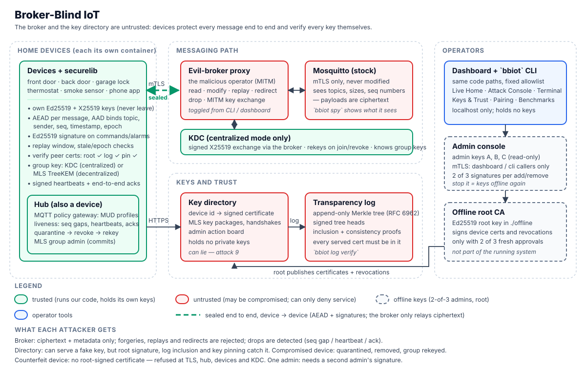

# broker-blind-iot

A smart-home system where devices talk over MQTT and **the broker and the key
directory are both untrusted**. Even if either is compromised, an attacker
cannot read, forge, replay, redirect, or silently drop device messages. Each
attack is shown live (security off vs. on), every action is a `bbiot` CLI
command, and the overhead is measured.



## Results at a glance

Every attack runs with security **OFF** (TLS only) and **ON** (broker-blind), from the
CLI or the dashboard, and each is covered by an integration test.

| # | Attack | OFF (TLS only) | ON (broker-blind) |
|---|---|---|---|
| 1 | Broker reads payloads | ✗ reads everything | ✓ blocked — ciphertext only |
| 2 | Broker changes a thermostat setpoint | ✗ 21 °C becomes 30 °C | ✓ blocked — tag invalid |
| 3 | Broker replays "unlock front door" | ✗ door unlocks again | ✓ blocked — replay window |
| 4 | Broker redirects the unlock to the back door | ✗ back door opens | ✓ blocked — wrong topic |
| 5 | Broker silently drops the smoke alarm | ✗ nobody notices | ◐ detected in 3–6 s (can't be prevented) |
| 6 | Broker MITMs the key exchange | ✗ unsigned DH: group key stolen | ✓ blocked — signature invalid |
| 7 | Compromised thermostat listens to door commands | ✗ reads them | ✓ quarantined, group rekeyed, can't decrypt new traffic |
| 8 | Counterfeit device joins | ✗ unlocks a door by bypassing the hub | ✓ refused at TLS, hub, devices and KDC |
| 9 | Compromised directory swaps a public key | ✗ a naive client trusts it | ✓ caught by root signature / log / pin (cert or MLS key package) |
| 10 | Compromised KDC vs. compromised directory | — | centralized: ✗ KDC reads everything · decentralized: ✓ nothing to read |

Cost (laptop, `bench/results/`): about **+0.1 ms** and **+41 B** per state update
(**+105 B** per signed command) on top of TLS; rekeying 1000 devices takes ~7 ms and
1000 messages with the KDC, ~42 ms and one commit with MLS.

## Quick start

Requirements: Docker (with Compose v2), [uv](https://docs.astral.sh/uv/), Python 3.11+.

```sh
docker compose up -d --build     # everything: PKI ceremony, broker, devices, dashboard, ...
uv sync --extra dev              # local Python env for the `bbiot` CLI
uv run bbiot doctor              # pre-flight: every service and device ✓
uv run bbiot demo start          # reset + security OFF + centralized: the demo's opening state
```

Then open <http://localhost:8000>. To present it, follow **[docs/DEMO.md](docs/DEMO.md)**
(a 15-minute script: what to click, what to type, what the audience sees).

## Project phases

All ten phases of the spec are done: scaffold · baseline + attacks 1–5 · identity and
PKI · message protection · centralized group keys · decentralized group keys (MLS) ·
liveness and policy · full dashboard · benchmarks · polish (demo flow, demo script,
architecture diagram, README).

## Architecture

Ports and processes (diagram above for the trust boundaries):

```
 devices ──mTLS──> hub gateway :8883 ──mTLS──> evil-broker ──mTLS──> Mosquitto (stock)
    │              (trusted; MUD policy,       host :8885       host :8884
    │               liveness, quarantine)      control API :8090 (arms attacks)
    ├──HTTPS──> key directory :8443 ──HTTPS──> transparency log :8444
    │           (public certs only)            (RFC 6962 Merkle tree)
    └──MQTT (via the broker)──> KDC  (signed X25519 key exchange, group keys, rekeys)
                                control API :8095

 offline/  root key + admin keys A/B/C — used by the one-shot ceremony containers
           (pki-init, commission), the admin's host CLI, and the admin console
 admin-console :8096 — the admins' signing station (mTLS, dashboard/cli only)
 dashboard :8000 — Live Home, Attack Console, Terminal, Keys & Trust, Pairing
```

- **evil-broker** is the malicious broker operator. It terminates client TLS with
  the broker's own certificate and forwards to Mosquitto. Unarmed, it is a
  transparent pass-through. Armed it modifies, redirects, drops and replays.
- **Devices** each run in their own container with a localhost-only **simulator
  control API**. `bbiot send` and the dashboard ask the *device* to send.
- **Security toggle** (`bbiot security on|off`, dashboard top bar): OFF = TLS only,
  the broker reads and changes everything; ON = broker-blind.

### Message protection (security ON)

Every message is sealed (`securelib/message.py`):

```
header (clear, authenticated): version | suite | epoch | seq | ts_ms | topic_tag | flags | sender | nonce
ciphertext: AEAD(message_key(epoch), nonce, [Ed25519 signature ||] body, AAD)
AAD = "bbiot-msg-v1" || topic || header
```

- AES-256-GCM (default) or ChaCha20-Poly1305 (`BBIOT_AEAD`), fresh random 96-bit nonce per
  message, per-epoch message key derived from the group key with HKDF.
- **Commands and alarms carry the sender's Ed25519 signature** inside the ciphertext, so
  even a group member can't impersonate another (e.g. a hacked thermostat sending
  "unlock" as the phone). State updates are AEAD-only.
- Receivers reject, with the reason shown in logs and on the dashboard:
  `wrong topic` · `wrong epoch` · `stale timestamp` (±30 s) · `replay` (64-message
  sliding window per sender, updated only after authentication) · `tag invalid` ·
  `bad signature` · `unknown sender` · `unsigned command` · `plaintext refused`.
- Sequence numbers survive restarts (blocks reserved on disk).

### Group keys: centralized mode (KDC)

- Devices and the KDC run a **signed ephemeral X25519 key exchange** over MQTT, i.e.
  through the untrusted broker (ISO 9798-3 style: each side signs a transcript with both
  identities and both shares). The resulting pairwise key wraps every group key.
- The KDC checks each joining device's certificate (root, log, pin, revocation).
- **Rekeys** (new epoch, fresh key) when a new device joins (it can't read old traffic),
  when a device is revoked (it can't read new traffic), or on request.
- Only the current epoch is accepted; a device that sees a newer epoch asks the KDC again.
- The KDC knows every group key — the centralized trade-off (attack 10).

### Group keys: decentralized mode (MLS)

`bbiot keymode decentralized` (or the dashboard toggle) switches every device to keys
derived among the devices themselves with **MLS (RFC 9420, TreeKEM)**:

- Each device runs its own **`bbiot-mls` sidecar** (Rust, OpenMLS 0.9, ciphersuite
  `MLS_128_DHKEMX25519_AES128GCM_SHA256_Ed25519`) as a subprocess inside its own
  container. MLS secrets never leave it.
- The **MLS signature key is the device's root-certified Ed25519 key**, so every key
  package, commit and welcome is bound to a certified identity.
- The group key for messages is the **MLS exporter** output for the current epoch, so the
  message layer is the same in both modes (a header flag says which mode sealed it, and
  only the active mode's key is accepted).
- One member is the **group admin** (`group_admin: phone` in home.yaml): it adds trusted
  devices and removes revoked/untrusted ones. Every member refuses commits from anyone
  else, and refuses any epoch containing a member whose MLS key ≠ its certified key.
- The directory is the untrusted **MLS delivery service**: it stores public key packages
  and handshake messages; a device that missed a commit (e.g. the broker dropped it)
  catches up from there.

### Hub: policy, liveness, quarantine

The hub is a commissioned device and the **MQTT gateway every client connects
through** (host :8883). It is trusted (it runs on the LAN gateway); the broker behind
it is not. With security ON:

- **MUD policy** — `config/mud/<id>.json` lists each identity's allowed publish topics,
  subscribe filters and command senders. The gateway checks every PUBLISH and SUBSCRIBE
  (a subscription filter must lie *inside* an allowed one, so wildcards can't widen it).
  Identities without a profile may do nothing. Devices also refuse commands from senders
  their profile doesn't allow. Regenerate after changing home.yaml:
  `uv run python -c "from securelib.config import load_config; from hub.policy import write_profiles; from pathlib import Path; write_profiles(load_config(), Path('config/mud'))"`.
- **Quarantine** on any violation: the connection is cut and refused from then on; a
  **signed, versioned quarantine notice** (retained on `hub/quarantine`) makes devices
  distrust the identity and the KDC remove it and rekey; as MLS admin the hub removes it
  from the MLS group; a `remove-device` action is posted for 2-of-3 admin confirmation.
- **Liveness** — critical devices send signed heartbeats every 5 s; every command is
  answered with a signed end-to-end ack (the sender alerts if it's missing); smoke alarms
  are acked by the hub and retried. The hub flags **sequence gaps** (it sees all of a
  device's traffic, and seq numbers are in every authenticated header), **missing
  heartbeats** and **unacknowledged alarms**, with time-to-detect.

The broker can still drop messages — it can't be prevented — but it can no longer do so
unnoticed.

### Identity and PKI

| Piece | What it does |
|---|---|
| Device keys | Each device generates Ed25519 (signing) + X25519 (key agreement) on first start, in its own key folder. Only a CSR leaves the device. |
| Device certificate | X.509 v3 over the Ed25519 key; X25519 key in a private non-critical extension (OID under `2.25`); custom EKU marks it as a device cert. Signed by the offline Ed25519 root. |
| Offline root | `offline/root.key`. Signs only when an add-device action carries valid signatures from **2 of 3 admins** and the CSR matches the approved hash. |
| Admins A/B/C | Ed25519 keys; their roster is signed by the root. Approvals are signatures over a domain-separated action digest. |
| Key directory | `device_id → certificate`. Untrusted, holds no secrets. Also a bulletin board for pending admin actions. Logs every cert it publishes. |
| Transparency log | Append-only RFC 6962 tree; signed tree heads (log key certified by the root); inclusion and consistency proofs. |
| Peer check (every device) | root signature ✓ → not revoked ✓ → STH signature ✓ → consistent with last STH seen ✓ → inclusion proof ✓ → key pin from first sight ✓. Any failure raises an alert. |
| Revocation | `remove-device` action, 2 of 3 admins → root-signed revocation (by certificate serial) → directory → devices refuse the peer, the KDC drops it and rekeys. A re-paired device (new certificate) can rejoin. |

## Layout

```
securelib/   shared device library (core of the project)
cli/         the `bbiot` CLI; cli/actions.py is shared with the dashboard
devices/     simulated locks, thermostat, smoke sensor, phone
evilbroker/  MQTT man-in-the-middle proxy that implements broker attacks
hub/         policy gateway (MUD), liveness monitor, quarantine notices, hub device
directory/   key directory (public certs only) + admin action board
translog/    RFC 6962 Merkle tree (merkle.py) + log service
rootca/      offline root CA (root.py), 2-of-3 admin approvals (approvals.py),
             admin console behind the dashboard's Approve buttons (console.py)
kdc/         Key Distribution Center (centralized group keys)
mls-sidecar/ Rust MLS sidecar on OpenMLS (decentralized group keys)
dashboard/   FastAPI backend (app.py) + React frontend (web/)
bench/       benchmarks (bench/*.py), results CSVs + charts (bench/results/)
broker/      Mosquitto configs: the home broker (stock, mTLS only), bench/ (benchmarks only)
config/      home.yaml: the fixed device and topic list
tests/       pytest suite
secrets/     generated keys and certs (git-ignored)
offline/     offline root + admin keys (git-ignored; mounted read-only only by the
             ceremony containers and the admin console)
scripts/     demo-tmux.sh (terminal demo layout)
docs/        DEMO.md (presenter script), architecture.svg / .png (diagram)
```

## Running it

Node 18+ is only needed for the frontend dev server.

```sh
docker compose up -d --build     # TLS + offline PKI ceremony, broker, evil broker, directory,
                                 # transparency log, devices, hub, KDC, admin console, dashboard
uv run bbiot doctor              # pre-flight checklist (exit code 1 if not ready)
uv run bbiot status              # every device's state
uv run bbiot log verify          # STH ✓, consistency ✓, every directory cert included ✓
uv run bbiot demo start          # reset to the demo's opening state (OFF, centralized)
uv run bbiot demo reset          # clear attacks/quarantines, keep the current modes
```

Dashboard: <http://localhost:8000>.

| Page | What it shows |
|---|---|
| Live Home | device cards, "what the broker sees" vs. "what the devices received", alert timeline |
| Attack Console | the 10 attacks: explanation, attacker type, Launch, an xterm.js panel with the exact `bbiot` command and its output, Copy; results matrix attack × (OFF/ON × Centralized/Decentralized) |
| Terminal | the `demo-tmux.sh` layout, live: broker spy, attacker, any component's log, hub alerts |
| Keys & Trust | directory entries verified like a device would (root, log inclusion, pin), signed tree head + Verify consistency, KDC members / MLS tree with the commit path, admin approvals with Approve A/B/C; red banner when the directory serves a bad key (stays until Reset demo) |
| Pairing | device found → certificate request verified → QR code compared → 2 of 3 admins → joined group → rekey; a counterfeit device stops red at the certificate step |

Every button runs the same code as a `bbiot` command and prints that command.
The Terminal page reads each component's recent log lines from its control API
(`/logs`), so it shows exactly what `docker compose logs` shows.

### Terminal demo (tmux)

```sh
scripts/demo-tmux.sh          # Linux / macOS / WSL; BBIOT="uv run bbiot" by default
```

Panes: broker spy (`bbiot spy --topic 'home/#'`), attacker shell, front-door log,
hub alerts, free shell.

### Admin console (dashboard approvals)

Admin keys and the root key never enter the dashboard. The **admin-console**
container mounts `offline/` read-only and does one thing: approve a pending action
as admin A, B or C (the same code as `bbiot admin approve`; at 2 of 3 the root
issues the certificate). It serves mutual TLS and answers only the `dashboard` and
`cli` client certificates — a compromised device with a valid transport cert gets
`403`. The directory still checks every approval against the root-signed admin
roster. `docker compose stop admin-console` takes the keys "offline" again: the
dashboard's Approve buttons are disabled and the host CLI keeps working.

### Demo: pairing a new device (2 of 3 admins)

`garage-lock` starts uncommissioned (badge "Unverified" with its pairing code).
Same flow on the dashboard's Pairing page. A device that already has a live
certificate for the same keys can't be paired again (`bbiot pair` refuses):
revocations name a certificate serial, so a second certificate would survive
revoking the first. Revoke it first (below, or the Revoke button on the Pairing
page), then pair it again — it rejoins and the group rekeys.

```sh
uv run bbiot pair --device garage-lock                  # verify CSR, compare codes, post action
uv run bbiot admin approve --admin A --action <id>      # 1/2
uv run bbiot admin approve --admin C --action <id>      # 2/2 → root signs → directory → log
uv run bbiot admin list                                 # the action board
uv run bbiot keys                                       # what the directory serves
uv run bbiot root issue --action <id>                   # refused with fewer than 2 approvals
```

### Demo: revoking a device

```sh
uv run bbiot revoke --device garage-lock                # remove-device action
uv run bbiot admin approve --admin A --action <id>
uv run bbiot admin approve --admin B --action <id>      # root signs revocation → KDC rekeys
uv run bbiot kdc status                                 # epoch, members, rekey history
```

### Demo: the broker attacks, security OFF vs ON

```sh
uv run bbiot spy                                          # what the broker sees (Ctrl+C)
uv run bbiot send --device phone --topic home/door/front/cmd --cmd unlock
uv run bbiot attack read                                  # 1. broker reads payloads
uv run bbiot attack modify --setpoint 30                  # 2. phone asks 21°C, thermostat gets 30°C
uv run bbiot attack replay                                # 3. captured unlock replayed
uv run bbiot attack replay --seq 3                        #    ...or a specific captured seq
uv run bbiot attack redirect --from home/door/front/cmd --to home/door/back/cmd   # 4.
uv run bbiot attack drop --topic home/smoke/kitchen       # 5. smoke alarm silently dropped
uv run bbiot attack mitm-dh --unsigned                    # 6. key exchange MITM (insecure DH)
uv run bbiot attack mitm-dh                               # 6. ...signed DH: caught
uv run bbiot attack compromised-device --device thermostat  # 7. subscribes to door topics
uv run bbiot attack counterfeit                           # 8. device without a root cert
uv run bbiot liveness                                     # heartbeats + drops as the hub sees them
uv run bbiot quarantine list                              # ... and release --device <id>
uv run bbiot attack swap-key --device thermostat          # 9. directory serves the attacker's key
uv run bbiot attack kdc-vs-directory                      # 10. compromised KDC + directory
uv run bbiot keymode decentralized                        # switch to MLS (and back: centralized)
uv run bbiot demo reset                                   # clear rules, reset devices
```

Run them with `bbiot security off`, then again with `bbiot security on`:

| Attack | Security OFF | Security ON |
|---|---|---|
| 1 read | ☠ broker reads JSON | 🛡 ciphertext only |
| 2 modify | ☠ thermostat set to 30°C | 🛡 `tag invalid` |
| 3 replay | ☠ door unlocks again | 🛡 `replay (seq N already seen)` |
| 4 redirect | ☠ back door unlocks | 🛡 `wrong topic` |
| 5 drop | ☠ alarm lost silently | 🔔 DETECTED by the hub (sequence gap / unacked alarm, with time-to-detect) |
| 6 MITM DH | ☠ `--unsigned`: group key stolen | 🛡 signed: `KDC signature invalid` |
| 7 compromised device | ☠ thermostat reads door commands | 🛡 hub blocks + quarantines, rekey; it can't decrypt new traffic |
| 8 counterfeit | ☠ unlocks the door (plaintext) | 🛡 refused at TLS, at the hub, by the door and by the KDC |
| 9 swap key | ☠ a client without verification trusts the attacker's key | 🛡 KDC mode: `certificate signature does not verify against the root` · MLS mode: `key package … NOT its certified key` |

Attack 10 depends on the key mode, not the security toggle:

| Attack 10 | Centralized (KDC) | Decentralized (MLS) |
|---|---|---|
| Compromised KDC leaks its key + compromised directory dumps everything | ☠ the KDC's key decrypts the traffic | 🛡 nothing decrypts it (thousands of candidate values from the directory tried; the KDC's key isn't accepted in MLS mode) |

Each prints the attacker's steps and a result line, e.g.

```
[attacker] armed: rewrite setpoint on home/thermostat/living/cmd to 30
[phone] → sent {"cmd": "set", "setpoint": 21.0} to home/thermostat/living/cmd
[attacker] ☠ RESULT: SUCCEEDED — phone asked for 21°C, thermostat accepted 30°C
```

The same attacks are buttons on the dashboard; each shows the exact `bbiot`
command it ran. Container logs show the other side:
`docker compose logs -f evil-broker front-door`.

### Standard tools against the broker

```sh
docker compose run --rm mqtt-tools mosquitto_sub -h broker -p 8883 \
  --cafile /certs/cli/ca.crt --cert /certs/cli/cert.pem --key /certs/cli/key.pem \
  -t 'home/#' -v

docker compose run --rm mqtt-tools mosquitto_pub -h evil-broker -p 8883 \
  --cafile /certs/phone/ca.crt --cert /certs/phone/cert.pem --key /certs/phone/key.pem \
  -t home/door/front/cmd -m '{"from":"phone","seq":1,"cmd":"unlock"}'
```

On Windows Git Bash, prefix these with `MSYS_NO_PATHCONV=1` so `/certs/...` isn't
rewritten to a Windows path.

## Benchmarks

```sh
uv run bbiot bench quick                     # ~10 s: crypto, message cost, groups 10/100, 1 drop
docker compose run --rm cli bench full       # report numbers: groups up to 1000 incl. MLS, charts
uv run bbiot bench crypto                    # crypto timings only (no broker needed)
uv run bbiot bench charts                    # redraw PNGs from the CSVs (matplotlib)
```

`bench full` runs inside the image because decentralized (MLS) needs the OpenMLS
sidecar; on the host, MLS rows are skipped with a note. Results go to
`bench/results/` (full) and `bench/results/quick/` (latest quick run, git-ignored);
the dashboard's Benchmarks page draws both and has a "Run quick benchmark" button.

| File | What | How |
|---|---|---|
| `message_bytes.csv` | bytes per message: plain MQTT vs TLS only vs ours, state update and signed command | real payloads; MQTT PUBLISH size computed exactly; TLS record overhead for the negotiated version (TLS 1.3: 22 B) |
| `message_latency.csv` | publish → received, median / p95 | through a separate benchmark Mosquitto (plain + mTLS listeners), one message in flight; "ours" includes sealing and every receive check |
| `crypto-<machine>.csv` | µs per primitive (Ed25519, X25519, HKDF, AES-GCM, ChaCha20) and per full seal / open / KDC handshake | `perf_counter_ns`, median / p95 |
| `groups.csv` | join / revoke / rekey at 10, 100, 1000 members: time at the KDC or MLS admin, time for one member, messages and bytes published | simulated members; the real `Kdc.rekey()` and real OpenMLS commits (sidecar `update` = rekey without membership change) |
| `drop_detection.csv` | seconds until the hub alerts on a dropped smoke alarm, and which check caught it | runs attack 5 against the live home (security ON) |
| `charts/*.png` | the same data as charts for the report | matplotlib |

Crypto timings are measured on the development laptop only (x86_64); no
Raspberry Pi or ESP32 was available, so there are no embedded-board numbers.

## Ports (all bound to 127.0.0.1)

| Port | Service |
|---|---|
| 8883 | hub policy gateway (where every client connects) |
| 8885 | evil-broker (behind the hub; reachable only to demo bypass attempts) |
| 8107 | hub control API (state, quarantine release) |
| 8884 | Mosquitto itself |
| 8090 | evil-broker control API |
| 8443 | key directory (HTTPS) |
| 8095 | KDC control API (status, rekey) |
| 8444 | transparency log (HTTPS) |
| 8101–8106 | device simulator APIs (front-door, back-door, thermostat, smoke-kitchen, phone, garage-lock) |
| 8000 | dashboard |
| 8096 | admin console (HTTPS, mutual TLS; dashboard / cli identities only) |
| 1885 / 8887 | benchmark-only Mosquitto: plain / mTLS listeners, `bench/` topics only |

## Tests

```sh
make test              # unit tests (or: uv run pytest -m "not integration")
make test-integration  # needs the stack up: OFF/ON matrix, attacks 6/9/10, both key modes,
                       # revocation, PKI
make test-mls          # MLS tests against the real OpenMLS sidecar (run inside the image)
make lint
```

On Windows without `make`, run the `uv run ...` lines from the `Makefile`
directly. For integration tests: `docker compose up -d --build`, set
`BBIOT_INTEGRATION=1`, run `uv run pytest -m integration`.

## Frontend development

```sh
cd dashboard/web && npm install && npm run dev    # http://127.0.0.1:5173, proxies to :8000
```

## Configuration

| Variable | Default | Meaning |
|---|---|---|
| `BBIOT_CONFIG` | `config/home.yaml` | devices and topics |
| `BBIOT_SECRETS_DIR` | `secrets` | where generated keys/certs go |
| `BBIOT_BROKER_HOST` / `_PORT` | from home.yaml | where clients connect (evil broker) |
| `BBIOT_MOSQUITTO_HOST` / `_PORT` | from home.yaml | Mosquitto itself (spy) |
| `BBIOT_PROXY_HOST` / `_PORT` | from home.yaml | evil-broker control API |
| `BBIOT_DEVICE_HOST` | `127.0.0.1` | device APIs; `service` = use device id as hostname |
| `BBIOT_DIRECTORY_HOST` / `_PORT` | from home.yaml | key directory |
| `BBIOT_TRANSLOG_HOST` / `_PORT` | from home.yaml | transparency log |
| `BBIOT_OFFLINE_DIR` | `offline` | root + admin keys (admin machine only) |
| `BBIOT_KDC_HOST` / `_PORT` | from home.yaml | KDC control API |
| `BBIOT_ADMIN_CONSOLE_HOST` / `_PORT` | from home.yaml | admin console |
| `BBIOT_SECURITY` | `on` | device default security mode (toggle persists per device) |
| `BBIOT_AEAD` | `AES-GCM` | or `ChaCha20-Poly1305` |
| `BBIOT_KEYMODE` | `centralized` | device default key mode (toggle persists per device) |
| `BBIOT_MLS_BIN` | `bbiot-mls` on PATH | MLS sidecar binary (in the image) |

## Dashboard security

The backend only runs a fixed allowlist of actions (`dashboard/app.py: ACTIONS`)
with validated parameters (device names from home.yaml, admins A/B/C, 12-hex action
ids), each mapped to the same function the CLI uses. No shell execution, no
free-text commands; the xterm.js panels are read-only. Everything binds to
localhost. The dashboard holds no admin or root keys (see Admin console).

## Transport TLS vs. end-to-end

The mTLS set up here protects the network link only — the broker (and the
evil proxy in front of it) still sees plaintext. That is the "security OFF"
baseline. With security ON, end-to-end protection (securelib) keeps the broker
blind: it still sees topics, sizes, senders and sequence numbers (metadata), but
cannot read, change, replay or redirect messages.

## Limitations

- **Drops can't be prevented**, only detected: a broker can always discard messages.
  Detection takes a few seconds (sequence gaps, heartbeats every 5 s, 3 s ack timeout).
- **Metadata is visible** to the broker: topics, sizes, sender ids, sequence numbers and
  timing. Only payloads are protected.
- **Centralized mode trusts the KDC** with every group key (attack 10); decentralized
  (MLS) mode removes that, at a higher per-rekey cost.
- **The offline root and admin keys are files** in `./offline`, standing in for real
  offline storage / hardware tokens. The admin console holds them while it runs.
  Admin approvals use simple 2-of-3 multi-signatures (no FROST).
- **Simulated devices**: Python processes in containers, not real hardware. Crypto
  timings come from the development laptop only; no Raspberry Pi or ESP32 was measured.
- **Out of scope** (per the threat model): physical tampering, side channels, broker
  denial of service, compromise of the offline root key.

### Starting over

`docker compose down -v` and deleting `secrets/` and `offline/` gives a fresh
home: the next `docker compose up` re-runs both ceremonies.
